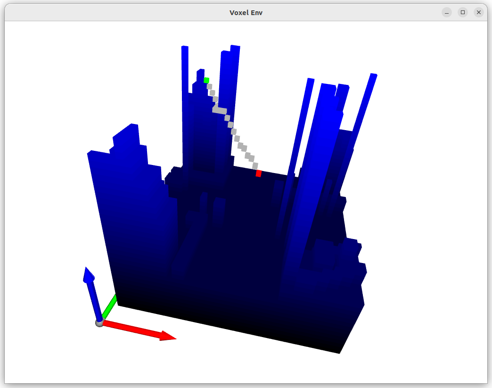
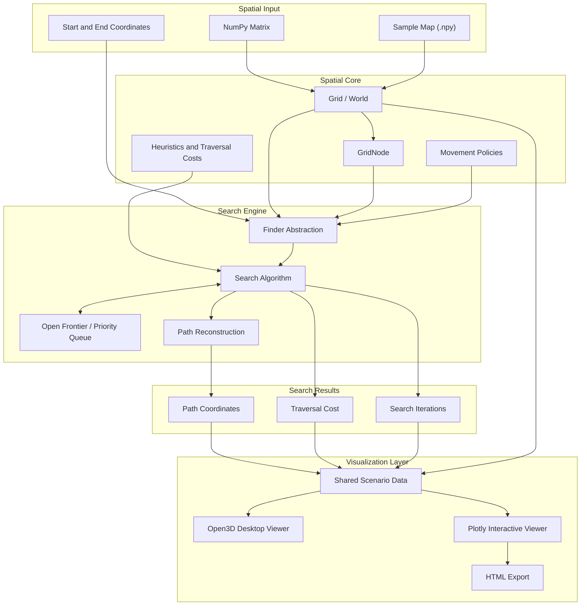
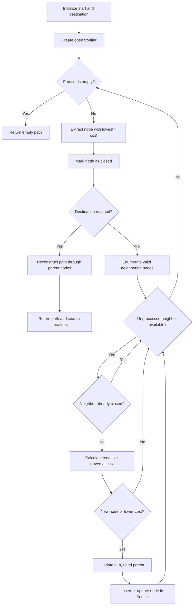
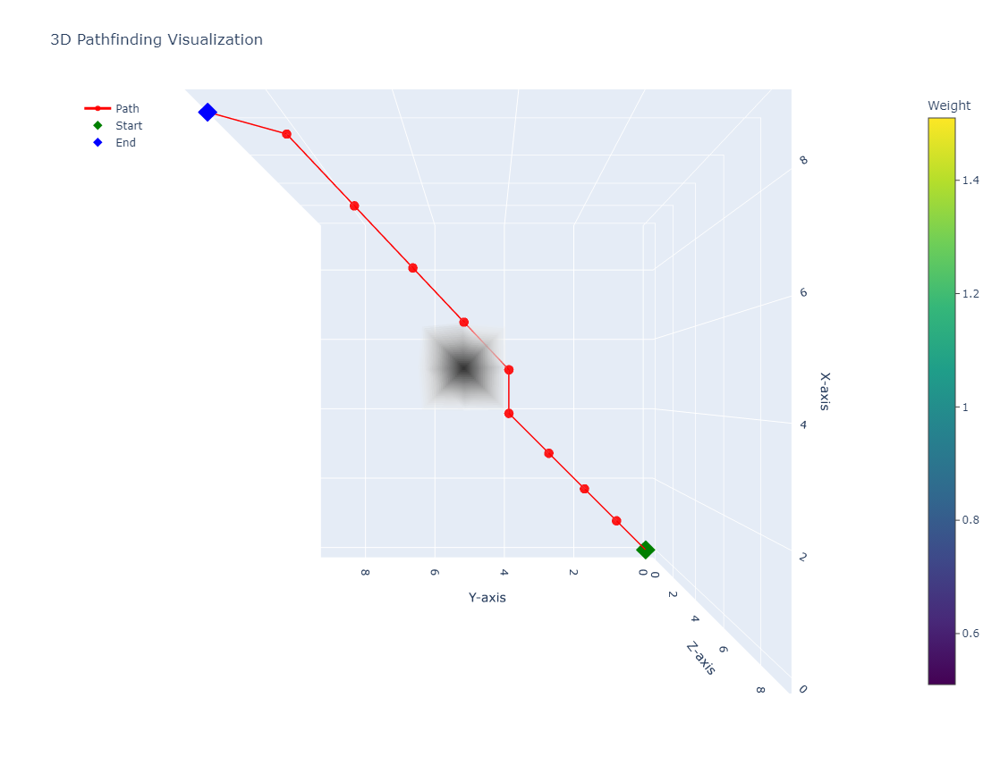
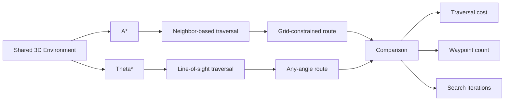

<div align="center">

  

  <h1>Pathfinding3D</h1>

  <p>
    <strong>Spatial search, intelligent navigation, and algorithm visualization.</strong>
  </p>

  <p>
    A Python toolkit for exploring pathfinding algorithms,
    navigating complex three-dimensional environments,
    and visualizing computational geometry.
  </p>

  [](https://www.python.org/)
  [](https://numpy.org/)
  [](https://www.open3d.org/)
  [](https://plotly.com/python/)
  [](./LICENSE)

  <p>
    <a href="#overview">Overview</a> ·
    <a href="#algorithms">Algorithms</a> ·
    <a href="#architecture">Architecture</a> ·
    <a href="#getting-started">Getting Started</a> ·
    <a href="#visualization">Visualization</a>
  </p>

  

  <sub>Exploring spatial navigation through three-dimensional voxel environments.</sub>

</div>

## Overview

Pathfinding3D is a modular Python toolkit for studying, executing, and
visualizing search algorithms in three-dimensional environments.

Unlike traditional two-dimensional pathfinding systems, this project
operates on volumetric grids, introducing an additional spatial
dimension to movement, obstacle avoidance, and route optimization.

The project combines a collection of established graph search algorithms
with numerical computing and interactive visualization tools, providing
an environment where algorithmic behavior can be explored from both
a computational and a visual perspective.

Its applications extend across several areas of computer science:

- Graph theory and heuristic search.
- Spatial computing and computational geometry.
- Robotics and autonomous navigation research.
- Game development and virtual environments.
- Procedural worlds and voxel-based simulations.
- Algorithm education and experimentation.

## Features

| Feature | Description |
| :--- | :--- |
| **3D Grid Navigation** | Represent and traverse volumetric environments using three-dimensional NumPy arrays. |
| **Multiple Algorithms** | Explore eight search and graph traversal implementations. |
| **Weighted Environments** | Assign different traversal costs to individual nodes using compatible algorithms. |
| **Diagonal Movement** | Configure movement policies across three-dimensional space. |
| **Connected Worlds** | Navigate between multiple interconnected spatial grids. |
| **Any-Angle Pathfinding** | Explore less constrained routes through Theta* and line-of-sight calculations. |
| **Desktop Visualization** | Inspect voxel environments and computed routes through Open3D. |
| **Interactive Visualization** | Explore and export browser-based three-dimensional scenes with Plotly. |
| **Algorithm Comparison** | Compare route costs, waypoint counts, and search iterations. |
| **Extensible Architecture** | Build additional search strategies through a shared finder abstraction. |

## Algorithms

The toolkit provides eight algorithm implementations, each addressing
different search strategies and computational requirements.

| Algorithm | Search Strategy | Primary Characteristic |
| :--- | :--- | :--- |
| **A\*** | Heuristic search | Balances accumulated cost and estimated distance to the goal. |
| **Dijkstra** | Uniform-cost search | Explores nodes according to their accumulated traversal cost. |
| **Best-First Search** | Greedy heuristic search | Prioritizes nodes estimated to be closest to the destination. |
| **Bidirectional A\*** | Two-frontier search | Searches from both the origin and destination. |
| **Breadth-First Search** | Level-order traversal | Explores neighboring nodes in successive layers. |
| **IDA\*** | Iterative deepening | Combines heuristic evaluation with progressively increasing cost thresholds. |
| **Minimum Spanning Tree** | Graph traversal | Builds a spanning structure from connected nodes. |
| **Theta\*** | Any-angle search | Uses line-of-sight relationships to reduce unnecessary grid-constrained turns. |

A*, Dijkstra, and Bidirectional A* support weighted traversal costs.

Theta* provides an alternative to conventional grid-constrained search
by allowing direct connections between nodes when line of sight is
available.

### Heuristic search

The A* algorithm evaluates candidate nodes using a combination of
accumulated traversal cost and estimated remaining distance:

$$
f(n) = g(n) + h(n)
$$

Where:

- $g(n)$ represents the accumulated cost from the starting node.
- $h(n)$ estimates the remaining cost to the destination.
- $f(n)$ determines the evaluation priority of the candidate node.

Dijkstra operates without a distance heuristic, while greedy Best-First
Search prioritizes the heuristic estimate.

The effectiveness of each strategy depends on the environment,
movement policy, cost model, and distribution of obstacles.

## Architecture

The project separates spatial representation, algorithm execution,
and visualization into distinct components.

The visualization layer consumes computed routes without requiring
either rendering backend to execute the search again.



### Core components

| Component | Responsibility |
| :--- | :--- |
| `Grid` | Represents a three-dimensional environment and its traversable nodes. |
| `GridNode` | Stores spatial coordinates, traversal costs, and search state. |
| `World` | Manages interconnected grids and navigation between them. |
| `DiagonalMovement` | Defines the permitted diagonal movement policies. |
| `Finder` | Provides shared functionality for search implementations. |
| `SimpleHeap` | Manages priority-based node exploration for compatible algorithms. |
| `Scenario` | Stores visualization-independent environment and route data. |

### Search lifecycle

The following diagram illustrates the execution flow of the A* finder,
from initialization to path reconstruction.



This structure allows search strategies to share common operations while
implementing their own evaluation rules and exploration behavior.

## Getting Started

### Requirements

| Dependency | Purpose |
| :--- | :--- |
| Python >= 3.8 | Core library runtime |
| NumPy | Volumetric arrays and numerical operations |
| Plotly | Optional browser-based visualization |
| Open3D | Optional desktop-based visualization |
| uv | Recommended environment and dependency management |

Python 3.12 is recommended for running the complete visualization
environment, subject to platform-specific Open3D availability.

### Clone the repository

```bash
git clone https://github.com/4beru/python-3d-pathfinding.git
cd python-3d-pathfinding
```

### Development environment

Create an isolated Python environment with `uv`:

```bash
uv venv --python 3.12 .venv
```

Install the core library in editable mode:

```bash
uv pip install --python .venv/bin/python -e .
```

For the complete environment, including both visualization backends
and testing dependencies:

```bash
uv pip install --python .venv/bin/python -e '.[vis,test]' open3d
```

Alternatively, activate the virtual environment and install the
dependencies using pip:

```bash
source .venv/bin/activate
python -m pip install -e '.[vis,test]' open3d
```

## Quick Start

The following example creates a volumetric environment, introduces
an obstacle region, and computes a route using A*.

```python
import numpy as np

from pathfinding3d.core.grid import Grid
from pathfinding3d.core.diagonal_movement import DiagonalMovement
from pathfinding3d.finder.a_star import AStarFinder


# Initialize a 12 x 12 x 12 volumetric environment.
matrix = np.ones((12, 12, 12), dtype=np.int8)

# Introduce an obstacle region.
matrix[4:8, 4:8, 4:8] = 0

# Build the spatial grid.
grid = Grid(matrix=matrix)

start = grid.node(0, 0, 0)
end = grid.node(11, 11, 11)

# Configure the search algorithm.
finder = AStarFinder(
    diagonal_movement=DiagonalMovement.only_when_no_obstacle
)

# Execute the search.
path, iterations = finder.find_path(start, end, grid)

# Extract the resulting coordinates.
coordinates = [(node.x, node.y, node.z) for node in path]

if path:
    print(f"Waypoints: {len(coordinates)}")
    print(f"Iterations: {iterations}")
    print(f"Traversal cost: {end.g:.4f}")
    print(f"Route: {coordinates}")
else:
    print("No traversable route found.")
```

### Spatial representation

The environment is represented as a three-dimensional numerical matrix.

| Cell value | Meaning |
| :---: | :--- |
| `0` | Obstacle |
| `1` | Traversable cell with standard cost |
| `> 1` | Traversable cell with increased cost |

Each cell corresponds to a spatial position identified by its
$(x, y, z)$ coordinates.

Weighted traversal costs are considered by algorithms that explicitly
support weighted environments.

### Reusing environments

Search algorithms modify the internal state of grid nodes during
execution.

Before running another search on the same environment, reset its
temporary search state:

```python
grid.cleanup()
```

Capture the required route coordinates and traversal cost before
performing cleanup.

This allows multiple algorithms to operate on the same spatial
environment without interference from previous searches.

## Visualization

Pathfinding3D provides two complementary approaches to exploring
three-dimensional environments and computed routes.

<div align="center">

  

  <sub>Interactive spatial visualization powered by Plotly.</sub>

</div>

### Visualization backends

| Capability | Open3D | Plotly |
| :--- | :---: | :---: |
| Three-dimensional navigation | Yes | Yes |
| Interactive camera | Yes | Yes |
| Obstacle visualization | Voxels | Markers |
| Route visualization | Yes | Yes |
| Desktop rendering | Yes | — |
| Browser rendering | — | Yes |
| Standalone HTML export | — | Yes |

Open3D provides a desktop-oriented environment for exploring voxel
geometry, while Plotly enables interactive browser-based inspection
and portable HTML exports.

Both backends can consume the same computed scenario data, making
it possible to compare identical routes across different rendering
environments.

### Visualization through the API

The `Grid` class also provides a built-in Plotly visualization method.

After computing a path, render the environment directly:

```python
grid.visualize(
    path=path,
    start=start,
    end=end,
    visualize_weight=True,
    save_html=True,
    save_to="path_visualization.html",
    always_show=True,
)
```

The resulting interactive scene includes the spatial environment,
obstacles, origin, destination, computed route, and optional
node-weight information.

## Interactive Scenarios

The repository includes a unified scenario runner for exploring
different spatial navigation problems.

Each scenario constructs an environment, executes its corresponding
search algorithm, and passes the resulting data to the selected
visualization backends.

### Available scenarios

| Scenario | Algorithm | Description |
| :--- | :--- | :--- |
| `basic` | A* | Navigation through a small 3 × 3 × 3 environment containing a central obstacle. |
| `connected` | A* | Navigation across two interconnected three-dimensional grids. |
| `sample` | A* | Exploration of a bundled volumetric map loaded from a NumPy file. |
| `theta` | A* and Theta* | Comparison of grid-constrained and any-angle routes. |

List all available scenarios:

```bash
.venv/bin/python examples/view_scenario.py --list
```

Run a basic pathfinding scenario:

```bash
.venv/bin/python examples/view_scenario.py --scenario basic
```

Explore interconnected spatial grids:

```bash
.venv/bin/python examples/view_scenario.py --scenario connected
```

Load and navigate the bundled sample environment:

```bash
.venv/bin/python examples/view_scenario.py --scenario sample
```

Compare A* and Theta*:

```bash
.venv/bin/python examples/view_scenario.py --scenario theta
```

### Selecting a visualization backend

Run the Open3D desktop viewer:

```bash
.venv/bin/python examples/view_scenario.py \
    --scenario sample \
    --viewer open3d
```

Run the Plotly browser viewer:

```bash
.venv/bin/python examples/view_scenario.py \
    --scenario sample \
    --viewer plotly
```

Run both visualization backends:

```bash
.venv/bin/python examples/view_scenario.py \
    --scenario theta \
    --viewer both
```

When both backends are selected, the application opens the Plotly
visualization followed by the Open3D desktop viewer.

### Visual conventions

Both scenario viewers use a consistent color palette to distinguish
spatial elements and computed routes.

| Color | Element |
| :--- | :--- |
| 🟦 Blue | Obstacles |
| 🟩 Green | Starting position |
| 🟪 Magenta | Destination |
| 🟥 Red | A* route |
| 🔹 Cyan | Theta* route |
| 🟧 Orange | Connection between spatial grids |

Routes may overlap when multiple algorithms select identical
segments of the environment.

The connected-grid scenario uses visual offsets to separate the
grids for presentation. Reported traversal costs are calculated
using the original coordinates rather than the displayed gap.

### HTML export

Plotly scenarios are exported as standalone HTML files:

```text
examples/output/
├── basic.html
├── connected.html
├── sample.html
└── theta.html
```

A custom output directory can be specified:

```bash
.venv/bin/python examples/view_scenario.py \
    --scenario sample \
    --viewer plotly \
    --output-dir ./visualizations
```

Exported files can be opened independently in a browser without
running the pathfinding algorithm again.

## Algorithm Comparison

The scenario runner reports three complementary metrics for evaluating
computed routes.

| Metric | Description |
| :--- | :--- |
| **Traversal Cost** | Accumulated cost of moving through the selected route. |
| **Waypoints** | Number of spatial nodes included in the resulting path. |
| **Iterations** | Number of search iterations reported by the finder. |

These metrics make it possible to investigate the differences between
search strategies using identical spatial environments.

For example, A* and Theta* approach navigation differently:



A route with fewer waypoints is not necessarily less expensive to
compute, and iteration counts should not be treated as direct
measurements of execution time.

The current visualization system displays completed routes rather
than animated, step-by-step frontier exploration.

## Project Structure

```text
python-3d-pathfinding/
│
├── assets/
│   ├── logo.png
│   ├── favicon.ico
│   ├── path_visualization.png
│   └── path_visualization.html
│
├── pathfinding3d/
│   ├── core/
│   │   ├── grid.py
│   │   ├── node.py
│   │   ├── world.py
│   │   ├── heap.py
│   │   ├── heuristic.py
│   │   ├── diagonal_movement.py
│   │   └── util.py
│   │
│   └── finder/
│       ├── finder.py
│       ├── a_star.py
│       ├── bi_a_star.py
│       ├── best_first.py
│       ├── breadth_first.py
│       ├── dijkstra.py
│       ├── ida_star.py
│       ├── msp.py
│       └── theta_star.py
│
├── examples/
│   ├── resources/
│   ├── 01_basic_usage.md
│   ├── 02_connecting_grids.md
│   ├── 03_view_map.py
│   ├── 04_theta_star.py
│   ├── sample_map.npy
│   ├── scenario_data.py
│   ├── scenario_viewers.py
│   └── view_scenario.py
│
├── docs/
├── test/
├── setup.py
├── setup.cfg
├── Makefile
├── LICENSE
└── README.md
```

The codebase is organized around three principal responsibilities:

- **Core** — Spatial representation, node state, movement policies,
  heuristics, and traversal costs.
- **Finder** — Search implementations and algorithm-specific behavior.
- **Examples** — Executable scenarios, visualization backends, and
  practical demonstrations.

## Testing

The project includes a test suite based on pytest.

Install the required testing dependencies:

```bash
uv pip install --python .venv/bin/python -e '.[test]'
```

Run the complete test suite:

```bash
.venv/bin/python -m pytest test
```

Generate a coverage report:

```bash
.venv/bin/python -m pytest test \
    --cov=pathfinding3d \
    --cov-report=term-missing
```

The test suite provides a foundation for validating spatial operations,
search behavior, and algorithm correctness.

## Documentation

Additional examples and implementation details are available within
the repository.

| Resource | Description |
| :--- | :--- |
| [Basic Usage](./examples/01_basic_usage.md) | Introduction to grid-based pathfinding. |
| [Connected Grids](./examples/02_connecting_grids.md) | Navigation across interconnected spatial environments. |
| [Open3D Example](./examples/03_view_map.py) | Volumetric environment visualization. |
| [Theta* Example](./examples/04_theta_star.py) | Any-angle pathfinding demonstration. |
| [Scenario Runner](./examples/view_scenario.py) | Unified visualization entry point. |
| [Documentation](./docs) | Additional technical documentation. |

## Technology Stack

<div align="center">

  

</div>

| Technology | Responsibility |
| :--- | :--- |
| **Python** | Core algorithm implementations and application logic. |
| **NumPy** | Numerical computing and volumetric data representation. |
| **Open3D** | Three-dimensional desktop graphics and voxel visualization. |
| **Plotly** | Interactive browser-based visualization and HTML exports. |
| **pytest** | Automated testing and regression validation. |
| **uv** | Python environment and dependency management. |
| **Setuptools** | Library packaging and distribution configuration. |

## Contributing

Contributions, technical discussions, and suggestions are welcome.

For bug reports, algorithm improvements, visualization enhancements,
or new scenario proposals, open an issue in the
[GitHub issue tracker](https://github.com/4beru/python-3d-pathfinding/issues).

---

<div align="center">

  <h3>Beyond the shortest path.</h3>

  <p>
    Part of <strong>Pathfinding Series</strong> — a collection of
    projects exploring graph theory, search algorithms,
    spatial computing, and creative visualization.
  </p>

  <p>
    <sub>Curated and extended by Abel Ortega.</sub>
  </p>

  <a href="https://github.com/4beru">GitHub</a> ·
  <a href="https://www.aberu.site">Portfolio</a>

</div>
